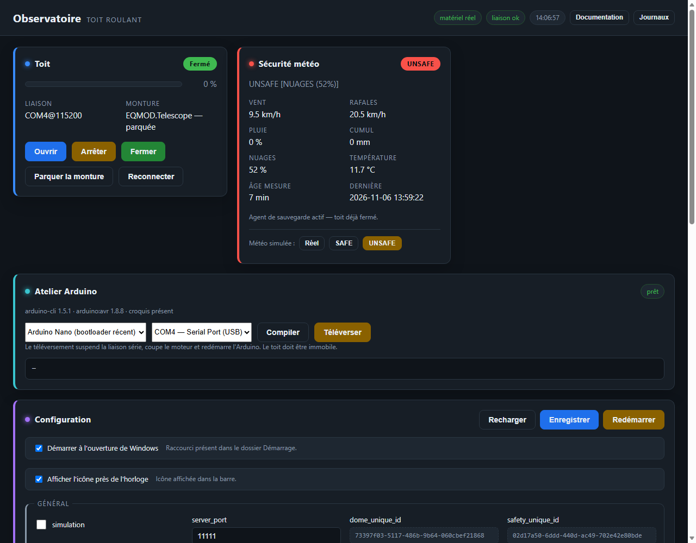
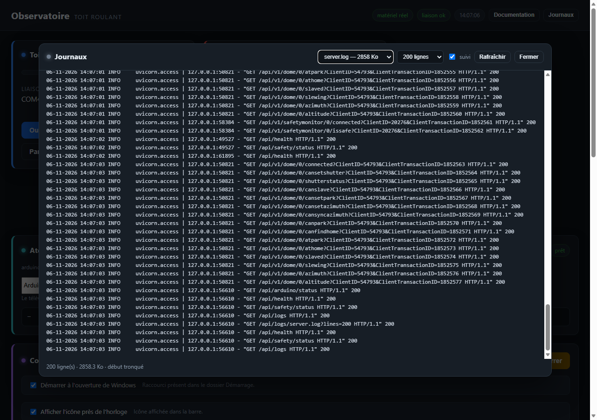
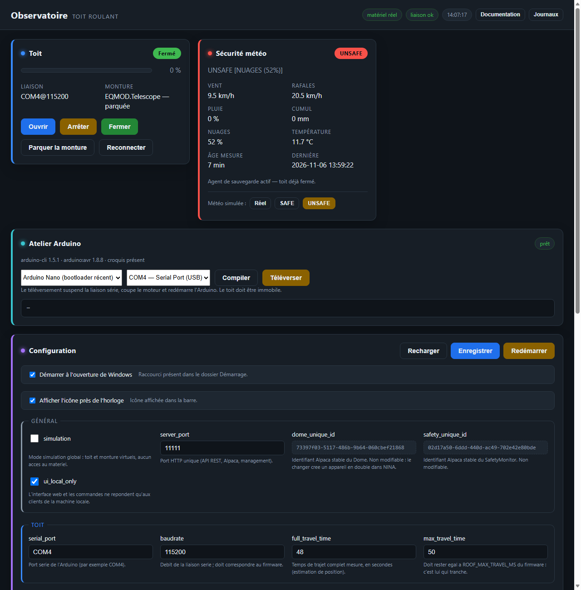
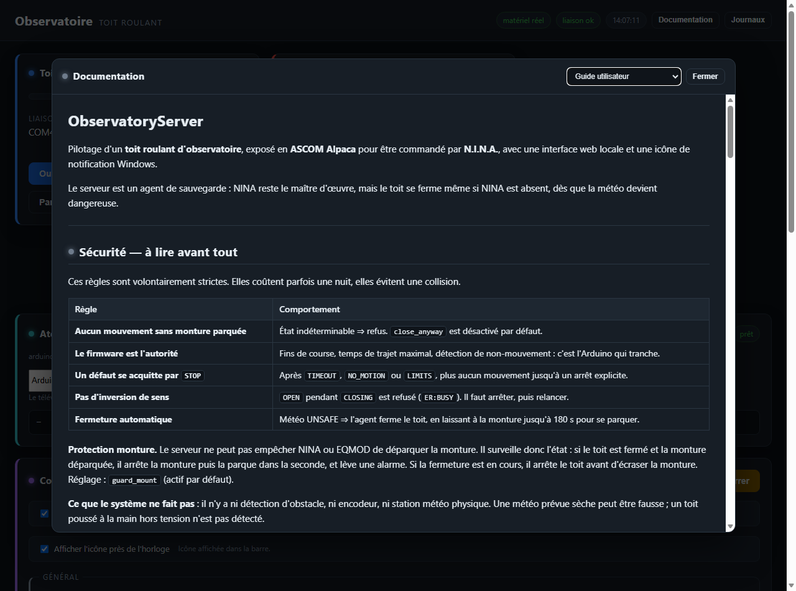

# ObservatoryServer

Pilotage d'un **toit roulant d'observatoire**, exposé en **ASCOM Alpaca** pour
être commandé par **N.I.N.A.**, avec une interface web locale et une icône de
notification Windows.

Le serveur est un agent de sauvegarde : NINA reste le maître d'œuvre, mais le
toit se ferme même si NINA est absent, dès que la météo devient dangereuse.

---

## Aperçu



| Journaux | Atelier Arduino |
|---|---|
|  |  |

La documentation est aussi consultable depuis l'interface :



---

## Sécurité — à lire avant tout

Ces règles sont volontairement strictes. Elles coûtent parfois une nuit, elles
évitent une collision.

| Règle | Comportement |
|---|---|
| **Aucun mouvement sans monture parquée** | État indéterminable ⇒ refus. `close_anyway` est désactivé par défaut. |
| **Le firmware est l'autorité** | Fins de course, temps de trajet maximal, détection de non-mouvement : c'est l'Arduino qui tranche. |
| **Un défaut se acquitte par `STOP`** | Après `TIMEOUT`, `NO_MOTION` ou `LIMITS`, plus aucun mouvement jusqu'à un arrêt explicite. |
| **Pas d'inversion de sens** | `OPEN` pendant `CLOSING` est refusé (`ER:BUSY`). Il faut arrêter, puis relancer. |
| **Fermeture automatique** | Météo UNSAFE ⇒ l'agent ferme le toit, en laissant à la monture jusqu'à 180 s pour se parquer. |

**Protection monture.** Le serveur ne peut pas empêcher NINA ou EQMOD de
déparquer la monture. Il surveille donc l'état : si le toit est fermé et la
monture déparquée, il arrête la monture puis la parque dans la seconde, et
lève une alarme. Si la fermeture est en cours, il arrête le toit avant
d'écraser la monture. Réglage : `guard_mount` (actif par défaut).

**Ce que le système ne fait pas** : il n'y a ni détection d'obstacle, ni
encodeur, ni station météo physique. Une météo prévue sèche peut être fausse ;
un toit poussé à la main hors tension n'est pas détecté.

---

## Matériel

| Élément | Détail |
|---|---|
| Toit | Moteur 12 V réducté, driver **BTS7960**, Arduino Nano ou Uno |
| Fins de course | Contacts **normalement fermés** vers GND (`INPUT_PULLUP`) : HIGH = en butée |
| Monture | ASCOM / **EQMOD** (ou `EQMOD_SIM` pour les essais) |
| Client | N.I.N.A. 3.x — device *Dome* + device *SafetyMonitor* |
| Météo | Open-Meteo, sans station physique |

Câblage détaillé et essai au banc : `firmware/RoofController/README.md`.

---

## Installation

1. Lancer **`ObservatoryServer-Setup-3.0.0.exe`**, accepter l'élévation UAC.
2. Options proposées : raccourci Bureau, **démarrage automatique**, règle de
   pare-feu sur le port 11111.
3. À la fin, l'icône apparaît près de l'horloge et le serveur démarre.

| Élément | Emplacement |
|---|---|
| Programme | `C:\Program Files\ObservatoryServer` |
| Données | `%ProgramData%\ObservatoryServer` (configuration, journaux, état) |
| Raccourcis | Menu Démarrer, Bureau, dossier Démarrage |

Prérequis pour l'atelier Arduino : **Arduino IDE 2.x** installé (il fournit
`arduino-cli` et le noyau AVR), ou `arduino-cli` dans le `PATH`.

---

## Premier démarrage

Par défaut, une installation neuve démarre en **simulation** : aucun accès au
matériel, le toit est virtuel. C'est volontaire — on peut tout essayer sans
risque.

Pour passer en réel :

1. ouvrir `http://localhost:11111/ui/` ;
2. décocher **`simulation`** dans la section Général ;
3. vérifier `serial_port` (COM4 par exemple) et `telescope_driver` ;
4. **Enregistrer**, puis **Redémarrer** (les réglages sont lus au démarrage).

L'icône près de l'horloge indique l'état : verte (fermé), orange (ouvert),
bleue (en mouvement), rouge (défaut). Menu : ouvrir l'interface, redémarrer,
quitter.

---

## L'interface web

**`http://localhost:11111/ui/`**

| Section | Contenu |
|---|---|
| **Toit** | état, position estimée, liaison série, monture, boutons Ouvrir / Arrêter / Fermer / Parquer |
| **Sécurité météo** | verdict SAFE/UNSAFE, vent, rafales, pluie, cumul, nuages, température, âge de la mesure |
| **Atelier Arduino** | compilation et téléversement du firmware |
| **Configuration** | les réglages, groupés par domaine |

L'agent réagit **immédiatement** à un changement de verdict (météo réelle ou
forçage) : il n'attend pas un cycle de surveillance. S'il doit parquer la
monture avant de fermer, le délai visible est celui du parkage, pas celui de
la décision. La ligne sous les mesures indique ce qu'il fait : « parkage en
cours », « attente du parkage », « toit fermé suite à la météo », etc.

La carte **Sécurité météo** contient trois boutons — **Réel**, **SAFE**,
**UNSAFE** — qui forcent le verdict pendant 10 minutes. C'est le moyen de
tester la fermeture automatique, le refus d'interlock ou le comportement de
NINA sans attendre la pluie. Le forçage est signalé par un bandeau, répercuté
dans Alpaca, et **expire tout seul** : impossible de l'oublier et de laisser
le toit ouvert (ou fermé) pour de bon.

Chaque section a sa couleur ; la carte météo passe au rouge quand le verdict
est UNSAFE. Le bouton **Documentation** ouvre le guide, la recette et la
documentation du firmware directement dans le navigateur ; le bouton
**Journaux** affiche les quatre journaux avec suivi automatique.

Les commandes demandent confirmation. Un refus est toujours expliqué (interlock,
mouvement opposé, défaut du contrôleur).

Le bouton **Reconnecter** ferme la session ASCOM et en ouvre une neuve. Si le
driver refuse encore de se connecter (cas d'EQMOD après une perte de liaison),
son processus est redémarré automatiquement — ce qui peut interrompre NINA.
Après reconnexion, la monture est généralement « non parquée » : la parquer
avant de fermer le toit.

### Configuration

Les réglages sont validés et typés côté serveur. Un réglage inconnu répond 404,
une valeur invalide 400 avec le motif. **La plupart ne s'appliquent qu'au
redémarrage** : utiliser le bouton Redémarrer après Enregistrer.

Les identifiants Alpaca (`dome_unique_id`, `safety_unique_id`) sont en lecture
seule : les changer créerait un appareil en double dans NINA.

Deux cases en haut de la configuration agissent immédiatement, sans
redémarrage :

- **« Démarrer à l'ouverture de Windows »** crée ou supprime le raccourci du
  dossier Démarrage ;
- **« Afficher l'icône près de l'horloge »** demande à Windows de sortir
  l'icône du menu chevron. Le réglage est propre à chaque icône, et Windows ne
  l'applique parfois qu'à la prochaine ouverture de session.

---

## Connexion dans NINA

1. **Equipment → Dome → Alpaca**, adresse `127.0.0.1`, port `11111`.
2. Sélectionner **Toit roulant** (ou laisser la découverte UDP 32227 trouver
   la machine, même sous-réseau).
3. Ajouter aussi **Sécurité météo** comme SafetyMonitor si vous voulez que
   NINA tienne compte du verdict.
4. Vérifier que NINA affiche **Closed** au repos.

Un toit roulant n'a ni azimut ni rotation : `CanFindHome` et `CanSlave` sont
faux, `AtPark` signifie « toit fermé ». Un refus de mouvement remonte en
**erreur Alpaca 1035** avec un message lisible.

---

## Firmware

L'atelier Arduino de l'interface permet de tout faire sans quitter le
navigateur :

1. choisir la carte (`Arduino Nano` bootloader récent ou ancien, `Uno`) et le
   port ;
2. **Compiler** pour vérifier ;
3. **Téléverser** pour flasher.

`roof_config.h` est **régénéré à chaque compilation** depuis la configuration :
brochage, temporisations, vitesses, débit série. La section Arduino de la
configuration contient ces valeurs.

Le téléversement **suspend la liaison série** (avrdude a besoin du port),
coupe le moteur et redémarre l'Arduino. Il est refusé si le toit est en
mouvement. Après le flash, le contrôleur redémarre : l'atelier attend qu'il
réponde avant de conclure.

---

## Réglages importants

| Réglage | Rôle |
|---|---|
| `simulation` | vrai = toit et monture virtuels, aucun accès matériel |
| `serial_port` / `baudrate` | liaison Arduino (115200 bauds) |
| `full_travel_time` | temps de trajet mesuré, pour l'estimation de position |
| `max_travel_time` | **doit rester égal** à `ROOF_MAX_TRAVEL_MS` du firmware |
| `safety_agent_enabled` | fermeture automatique sur météo UNSAFE |
| `auto_park_mount` | l'agent peut parquer la monture lui-même (installation non surveillée) |
| `guard_mount` | toit fermé + monture déparquée : arrêt de la monture et parkage immédiat ; arrêt du toit s'il ferme |
| `park_grace_seconds` | temps laissé à la monture pour se parquer |
| `close_anyway` | fermer malgré une monture non parquée — dangereux, laisser faux |
| `ui_local_only` | interface et commandes réservées à la machine locale |
| `arduino_fqbn` | carte cible de l'atelier |

La valeur `max_travel_time` ne doit **jamais** être inférieure au trajet réel :
le firmware doit couper avant le serveur, pas l'inverse.

---

## Mise à jour et désinstallation

**Mise à jour** : quitter l'application (icône → **Quitter**), puis lancer le
nouvel installateur. Le programme est remplacé, les données sont conservées.

> L'installateur ne parvient pas à fermer l'icône lui-même : s'il la trouve
> active, il annule en mode silencieux (code 5). C'est pour cela qu'il faut
> quitter l'application d'abord.

**Désinstallation** : Programmes et fonctionnalités → ObservatoryServer. Le
programme et la règle de pare-feu sont retirés, **`%ProgramData%` est
conservé** (configuration, journaux, état). Supprimer ce dossier à la main pour
repartir de zéro.

---

## Dépannage

| Symptôme | Cause probable | Action |
|---|---|---|
| L'icône n'apparaît pas | une instance tourne déjà | vérifier la zone de notification |
| « hors ligne — COM4 » | port tenu par l'IDE ou un autre serveur | fermer l'IDE, redémarrer l'application |
| `MOUNT_UNKNOWN` | EQMOD non lancé, ou liaison perdue | bouton **Reconnecter**, puis parquer |
| Monture perdue après débranchement | EQMOD reste bloqué même rebranché | **Reconnecter** : ferme la session, redémarre le driver si besoin |
| Refus 1035 « mouvement opposé » | inversion demandée en cours de trajet | Arrêter, puis relancer |
| Refus 1035 « défaut » | `TIMEOUT`, `NO_MOTION` ou `LIMITS` | vérifier le toit, puis `STOP` pour acquitter |
| Le toit ne bouge pas | butée déjà atteinte, défaut, ou monture non parquée | lire le message de refus |
| `TIMEOUT` en cours de trajet | trajet plus long que `max_travel_time` | vérifier la mécanique, augmenter les deux valeurs ensemble |
| Téléversement échoue | port occupé, mauvaise carte | fermer l'IDE, essayer l'ancien bootloader |
| L'interface ne change pas | ancien fichier en cache | `Ctrl+F5` |
| Le toit se referme pendant un essai | agent de sauvegarde actif, météo UNSAFE | décocher `safety_agent_enabled` |
| Port 11111 occupé | autre instance | quitter l'icône, relancer |

---

## Fichiers et journaux

```
%ProgramData%\ObservatoryServer\
  config\settings.json     configuration (JSON, modifiable à la main)
  logs\server.log          serveur (applicatif + accès HTTP)
  logs\tray.log            icône et supervision
  logs\roof.log            commandes du toit, monture
  logs\meteo_log.txt       décisions météo
  state\roof_state.json    dernier état connu du toit
```

Les journaux sont datés (`jj-mm-aaaa hh:mm:ss`) et consultables depuis le
bouton **Journaux**. `roof.log` et `meteo_log.txt` sont purgés après 48 h ;
`server.log` tourne automatiquement (5 Mo × 5 fichiers, soit 25 Mo au
maximum), car chaque requête HTTP y laisse une ligne.

---

## Limites connues

- **Pas d'encodeur** : un toit déplacé à la main hors tension n'est pas détecté.
- Une butée collée n'est vue qu'en tentant de quitter la position (`NO_MOTION`).
- Le PWM du BTS7960 siffle légèrement (~980 Hz), sans conséquence mécanique.
- La météo est une **prévision**, pas une mesure : elle peut se tromper.
- Pas d'authentification : l'interface est locale par défaut, le pare-feu doit
  être restreint si le port est exposé.
- Un seul drapeau `simulation` pilote le toit et la monture.

---

## Développement

```powershell
.\.venv\Scripts\python.exe -m pytest                 # 165 tests
.\.venv\Scripts\python.exe -m backend.run_api        # serveur de développement
packaging\build.cmd -Clean                           # exe (dist\ObservatoryServer)
packaging\build_installer.cmd                        # installateur Inno Setup
```

L'état d'avancement, les décisions techniques et l'historique sont dans
`HANDOFF.md`. Le protocole de recette est dans `docs/RECETTE.md`.
